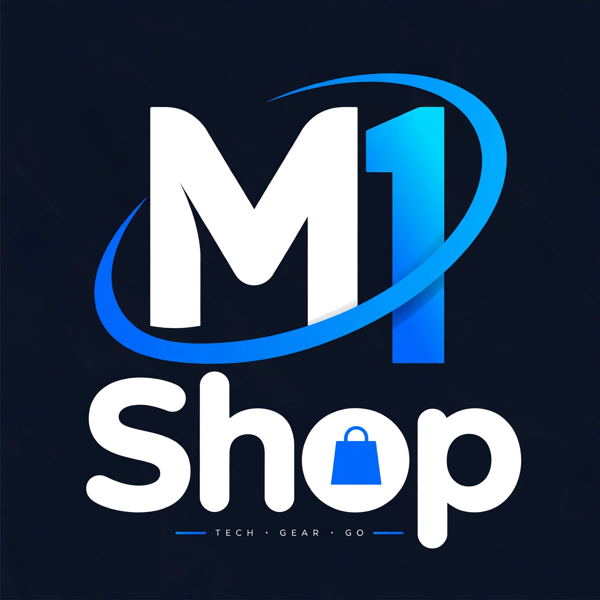
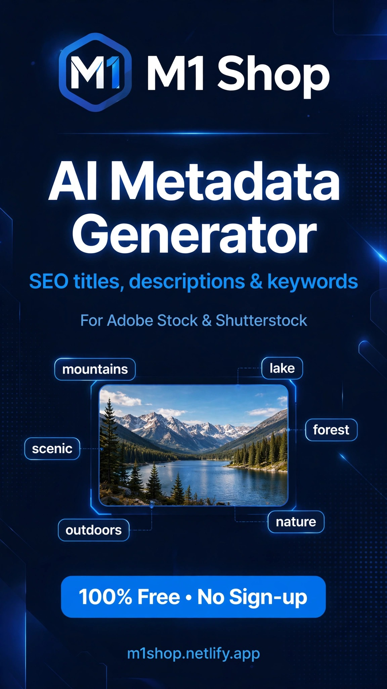
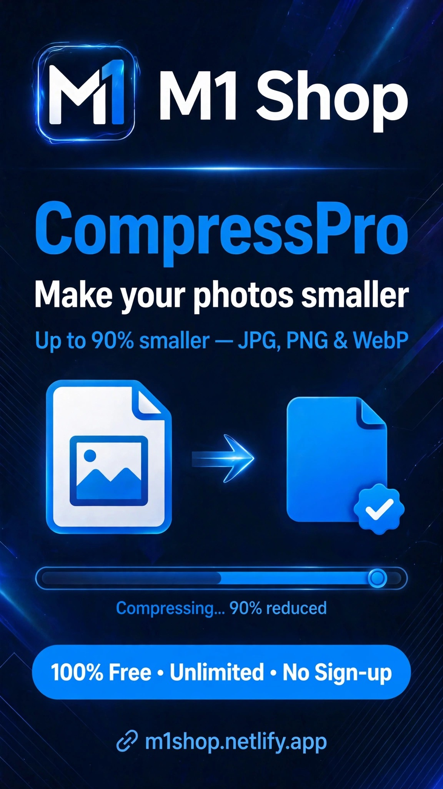
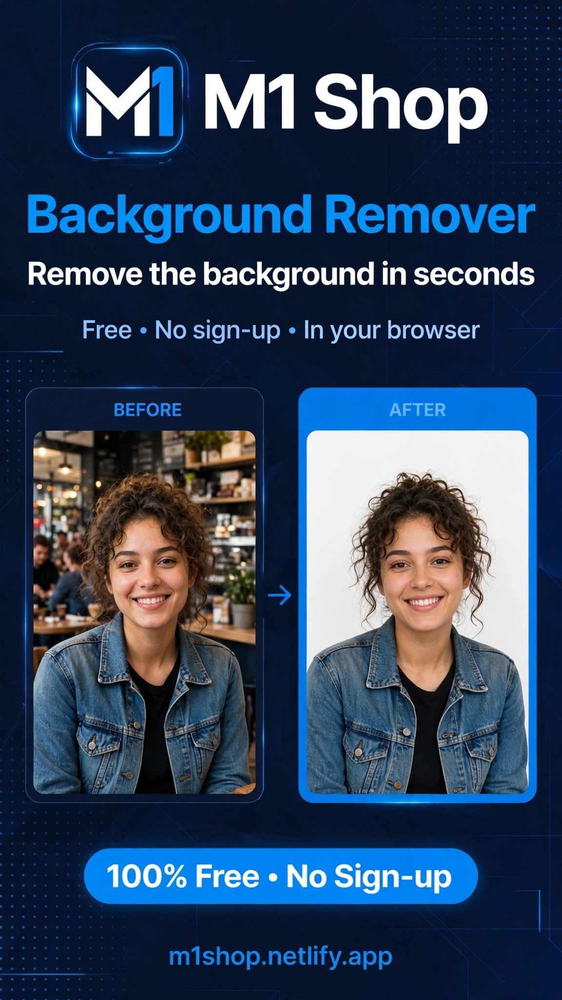

# 🛍️ M1 Shop — MShop · The Free Shop for All

  

  <strong>Free AI metadata generator & image tools for stock contributors — 100% free, unlimited, no sign-up.</strong> 
  🌐 <a href="https://m1shop.netlify.app">m1shop.netlify.app</a> · 📸 Free · ♾️ Unlimited · 🔓 No sign-up · 🔑 No key needed for most tools

  <a href="https://m1shop.netlify.app">🚀 Try M1 Shop — it's free</a> ·
  <a href="https://www.facebook.com/Mob1.shop">📘 Facebook Page</a> ·
  <a href="https://github.com/mobasherul1/pixelscope-pro">🔍 PixelScope Pro</a>

---

## ✨ What is M1 Shop?

**M1 Shop (MShop) is a free shop for all: an AI microstock metadata generator for stock contributors, plus image tools that run entirely in your browser.** 🎨📷

Upload a photo, let Gemini analyse it, and get an **SEO title, description and keywords** — then strip the old metadata, embed the new one, and export ready-to-upload files and **CSVs for every major stock platform**. 🚀

> 💎 **Our motto: premium features, unlimited use.**
>
> 🆓 **Free and unlimited.** No credits, no daily limits, no premium tier. Full-resolution downloads are always free here — including the transparent PNG from the Background Remover, the same download other sites charge for or downgrade.

### 👥 Who is it for?

| 👤 You are… | 🎯 M1 Shop helps you… |
|---|---|
| 📸 **Stock photographer / contributor** | Write SEO titles, descriptions & keywords that help buyers find your photos on Adobe Stock, Shutterstock, Freepik and more |
| 🖼️ **Designer / creator** | Compress, remove backgrounds, resize, crop and edit photos — free, in your browser |
| 🛒 **WooCommerce / online seller** | Optimise product photos and write SEO-ready listings |
| 🎓 **Student / beginner** | Learn stock photography workflow with free tools — no account, no card, no risk |
| 💼 **Freelancer** | Prepare client photos fast: metadata, compression, watermarks, PDFs and QR codes in one place |

### 🏷️ What does the name mean?

- **M** — the first letter of the founder's first name: **Md. Mobasherul Hasan**
- **1** — one project, built as one
- **Shop** — like shops where people buy and pay… except here, **all software services are free** (for now)

---

## 🧰 All the tools — at a glance

| # | 🛠️ Tool | ✨ What it does | 🔑 Key needed? |
|---|---|---|---|
| 1 | 🤖 **AI Metadata Generator** | SEO titles, descriptions & keywords from your photo | Yes — your own Gemini key |
| 2 | 📈 **SEO Pack & Direct Injector** | 25 SEO targets, live SEO score & checklist | With Generator |
| 3 | 🔍 **Trend Hunter** | Sub-niches buyers are searching for, with demand & opportunity scores | Yes — Gemini |
| 4 | 📦 **CompressPro** | Compress JPG, PNG & WebP by up to 90% | ❌ No |
| 5 | 🖼️ **Background Remover** | Remove the background, instantly, in your browser | ❌ No |
| 6 | 💧 **Watermark Remover** | Rebuild a marked area with real surrounding texture | ❌ No |
| 7 | ✂️ **Resizer & Crop** | High-quality resize & exact crop | ❌ No |
| 8 | 🎨 **Image Editor** | Resize, rotate, colour, text, frames & more | ❌ No |
| 9 | ©️ **Add Watermark** | 7 ready-made designs + your own custom watermark | ❌ No |
| 10 | 🧺 **Shared Tray** | Upload once, use the same photo in every tool | ❌ No |
| 11 | 📄 **PDF Tools** | Compress, merge, extract, rotate, split & more | ❌ No |
| 12 | 🧰 **Free Tools** | Image ⇄ PDF, SVG converter, YouTube thumbnails, QR, counters & more | ❌ No |
| 13 | 🔎 **AI Content Checker** | Style check — how much of a text reads AI-generated, refined, or human-typed | ❌ No (optional Gemini deep audit) |
| 14 | 🎓 **SOP Outline & Practice Kit** | Plan a Statement of Purpose in your own words | ❌ No |

> 💡 **No key? Start with Background Remover or CompressPro** — they need no key at all, no sign-up, and no account.

---

## 🤖 1. AI Metadata Generator — the heart of M1 Shop

  

**What it does:** you upload a photo, Gemini analyses what is actually in it, and you get a **search-ready SEO title, description and keywords** — written the way stock buyers search, not the way a camera names a file.

**How it works, step by step:**

1. 📤 **Upload** one photo — or many at once (batch generate them all together)
2. 🔑 **Add your own Gemini key** — session-only option available, so it is kept only until you close the tab
3. 🎯 **Choose your target platform** — Adobe Stock, Shutterstock, Freepik, and more, or add your own SEO target for this session
4. ⚙️ **Tune it** — title length (up to 180 characters, or Auto), keyword count (35 by default), language, category hint, custom prompt, rights & credits
5. ✨ **Hit Generate** — Gemini reads the image and writes the metadata
6. ✅ **Check readiness** — the Readiness Checker and Metadata Verifier check the result before you upload it anywhere
7. 💾 **Export** — strip the old metadata, embed the new one (EXIF + XMP) into the file, download the ready-to-upload photo, and export the **platform CSV** (Adobe Stock, Shutterstock, and others)

**What you get in every result:**

- 🏷️ **SEO title** — up to 180 characters, written for search
- 📝 **SEO description** — clear, keyword-rich, buyer-friendly
- 🔑 **Keywords** — 35 by default, ranked by relevance
- 📁 **SEO file name** — a search-friendly name for the downloaded file
- 📊 **Live SEO score & checklist** — on every result, so you can see what is strong and what to improve
- 🗂️ **Local History** — past generations saved in your browser, reusable and deletable

**Platform CSVs:** export ready-made CSVs for Adobe Stock, Shutterstock and other major stock platforms — copy, paste, upload. No retyping keywords one by one.

---

## 📈 2. SEO Pack & Direct Injector

**25 SEO targets** across stock agencies, YouTube, websites, e-commerce, and Freelance & Social (Fiverr, LinkedIn, Facebook, Instagram) — with a **live SEO score and checklist on every result**.

Pick a target, and the Generator writes the metadata in that target's style and rules: what buyers on Adobe Stock search for is not what viewers on YouTube search for, and the SEO Pack knows the difference.

---

## 🔍 3. Trend Hunter

**Find what to shoot next — before everyone else shoots it.**

Trend Hunter finds **sub-niches buyers are searching for**, and scores each one:

- 📊 **Demand** — how much buyers want it
- ⚔️ **Competition** — how crowded it already is
- 💡 **Opportunity score** — demand vs. competition, so you can spot the gaps
- 🔑 **Keywords to shoot and upload next** — so your next shoot is already SEO-ready

> ⚠️ Trend scores are AI estimates to guide your shoot list — check them against each marketplace's own insights before a big production.

---

## 📦 4. CompressPro — compress by up to 90%

  

**Free online image optimizer. 100% free · Unlimited.**

- 🖼️ **JPG, PNG and WebP** — drop images in, or click to browse
- 📉 **Compress by up to 90%** — with live size and quality control
- 👀 **Live side-by-side preview** — see the original vs. compressed, while you adjust
- 📐 **Downscale-only resizing** and **format conversion** — never enlarges, never degrades
- ⚡ **Runs live** while Live preview is on — compression starts as you change the settings
- 🔑 **No key, no sign-up, no limit**

Perfect for: stock uploads, WooCommerce product photos, websites, and anywhere a smaller file means a faster page.

---

## 🖼️ 5. Background Remover — Advanced Premium · Free · Unlimited

  

**Remove the background from any photo — instantly, in your browser, with no model download.**

**How it works:**

- 🧠 **Classic edge-detection removal** — edge-connected detection with saturated-colour and interior-foreground safeguards, plus soft edge finishing
- 🤖 **Optional Gemini subject guide** — for hard cases, Gemini helps identify the subject
- ✋ **Refine edges by hand** — clean up the tricky parts yourself
- 🎯 **Custom Area Select** — pick one area only, and remove just that
- 🖼️ **Replace the background** — put your subject on a new background
- 💾 **Download exactly the size and quality you set** — including the **full-resolution transparent PNG, free** (the same download other sites charge for or downgrade)

**Works best on:** a simple photo with a clear subject first.

> ⚠️ **Permission note — please read:** only use this tool on images you own or have permission to edit. Do not use it to remove watermarks from stock preview images or other people's licensed images — those watermarks protect the creator's rights, and removing them to use or sell the image breaches the licence and copyright law in most places.

---

## 💧 6. Watermark Remover

**Rebuild a marked area with real texture copied from surrounding patches** — not a blur, not a smudge.

- 🖌️ **Clone Stamp** and **Healing Brush** for hand finishing
- 🎯 Mark the watermark area, and the tool rebuilds it from the photo itself

> ⚠️ Only use the Watermark Remover on images **you own or have permission to edit**. A watermark marks ownership — do not remove one from someone else's photo and present it as your own.

---

## ✂️ 7. Resizer & Crop

- 📐 **Shrink a photo with the stepped high-quality resize engine** — it never enlarges
- 🖼️ **Crop to an exact size** by arranging the photo inside a fixed frame, like Photoshop transform
- 🖱️ **Free drag-rectangle crop**
- 💎 **Crop only mode** — keeps the selected area pixel-for-pixel at native resolution

---

## 🎨 8. Image Editor

**One photo, one tool at a time — each with a live preview, Apply / Cancel, and Undo / Redo, all in your browser:**

Resize · Native Crop · Rotate / Flip · Colour Adjust · Text · Convert · Border · Round Corners · Vignette / Passe-Partout · Click-colour Transparency · Overlay Image · Expand Canvas · Cut Shapes · Speech Bubble · Photo Frame · Image in Text

Need full Photoshop-style editing — layers, PSD files, advanced retouching? The site links out to **Photopea**, a free online photo editor (an external site, not part of MShop).

---

## ©️ 9. Add Watermark

- 🎨 **7 ready-made watermark designs**, plus a custom one with your own text or PNG
- 🌈 Professional colours
- 💻 **Advanced CSS option** for unlimited styling

---

## 🧺 10. Shared Tray — upload once, use everywhere

- 📤 **Upload once** and use the same photo in **every tool**
- 🔄 Choose **Original or the worked version** each time
- 🕘 **Version history per photo**
- ⚡ **One-click workflow recipes**
- ⬇️ **Download Centre**

Your tray photos are stored only in your own browser (IndexedDB, on your own device) — they survive a reload, a closed tab and a new tab in the same browser and profile, until you press **Clear saved photos**, clear the browser's site data, or the browser evicts storage. They do not transfer to another browser or device.

---

## 📄 11. PDF Tools

Everything runs in your browser — **PDFs are never uploaded to any server.**

| 🛠️ Tool | ✨ What it does |
|---|---|
| 🗜️ **PDF Compressor** | Live compression with original vs. compressed sizes, a size bar, and a per-page quality preview |
| 🔗 **PDF Merger** | Merge two or more PDFs, in the order you list them |
| 📤 **PDF Extractor** | Extract pages to a new PDF |
| 🔄 **PDF Rotator** | Rotate pages by angle, page range, or all pages |
| ✂️ **PDF Splitter** | Split one PDF into separate files |
| 🔢 **Page Numbering** | Add "Page X of Y" with position, font size and starting number |
| ✂️ **PDF Cropper** | Draw a crop box on page 1 and apply it with margins |

---

## 🧰 12. Free Tools

| 🛠️ Tool | ✨ What it does |
|---|---|
| 🖼️ **Image ⇄ PDF** | Images into a PDF, and PDF pages back to images |
| 🔺 **SVG Converter** | Convert SVG files |
| ▶️ **YouTube Thumbnail Downloader** | Download a video's thumbnail from its URL or ID |
| 🔢 **Character / Word Counter** | Words, characters, sentences, reading time |
| 🔳 **QR Generator** | Make a QR code from text or a URL |
| 🎂 **Age Calculator** | Calculate age from a date of birth |

---

## 🔎 13. AI Content Checker

**A quick, private, free second look at your writing — from style only, never as proof of authorship.**

It measures, openly in your browser: sentence-length evenness (burstiness), stock AI phrases, formal report-style vocabulary, the share of everyday glue words, repeated phrases and openers, and average word length — then shows you **each measurement instead of hiding it inside one verdict**.

Each sentence is read two ways at once: how strong its AI-like signals are, and how many **human touches** it carries (true contractions, concrete specifics like names and numbers, questions, exclamations, irregular length).

- Strong signals + few touches → **AI-generated**
- Signals mixed with touches → **AI-refined / humanized**
- Weak signals → **human-typed**

Shown as a **five-band resemblance map with an Uncertain middle**, a separate readability score, and flags for hidden characters.

> ⚠️ **No accuracy claim** — detectors detect patterns, not authorship. Formal, simple, translated and non-native writing gets flagged; edited or humanized AI text slips through. This checker is a signal for review, not proof.

**Optional Gemini deep audit:** tick "Deep audit with Gemini" and the same text is sent to Google Gemini with the key saved in your browser, under a forensic brief — it audits word choice, grammar, spelling and punctuation in separate passes, and returns its own three-way split with a reason for every sentence. Its result is always shown **separately**, never merged into one number.

---

## 🎓 14. SOP Outline & Practice Kit

**Plan a Statement of Purpose in your own words.**

- 📝 **Outline builder** — Introduction, Academic Background, Experience, Why This Programme, Goals, Conclusion — with degree templates
- 👀 **Local readability checks** and an **own-text overlap check** (only between passages you paste here, in your browser — it does not search the web, does not use Turnitin, and does not prove a document is plagiarism-free)
- 🎤 **Visa-interview practice** — practice questions and a timer, with a self-check checklist
- ✅ **Application checklist** — passport, transcripts, test scores, SOP, recommendation letters, financial documents, deadlines
- 💾 **Drafts saved only in this browser** on this device — clearing browser data deletes them. Nothing is uploaded or synced.

> The words must be yours. No template guarantees admission or originality.

---

## 🚀 How to use M1 Shop

1. 🌐 **Open** https://m1shop.netlify.app — no sign-up, no login, just start working
2. 🖼️ **Upload a photo** in any tool — or add it to the Shared Tray and use it everywhere
3. 🤖 **For the Generator / Trend Hunter:** add your own Gemini key (session-only if you like), pick a platform, hit Generate
4. 📦 **For the free tools:** no key needed — CompressPro, Background Remover, Watermark Remover, Resizer, Editor, PDFs and Free Tools all work straight away
5. 💾 **Download** — full-resolution, free, unlimited

**🎨 Themes:** Dark, Light, Eye Care, Ocean — pick the one you like.

---

## 🔒 Privacy — your files stay yours

- 🆓 **Free, with no account.** MShop needs no sign-up and no login — you arrive and start working. There is no MShop account holding your details, because there is no account at all.
- 💻 **Everything runs in your browser.** Every tool works on your own device. **No photo is uploaded to an MShop server** — MShop has no server receiving your files. The only file that ever leaves your device is the analysis copy **you choose to send to Google's Gemini** when you run the Generator or Trend Hunter.
- 📄 **PDFs stay in your browser too.** The PDF Compressor processes PDFs only in your browser — they are never uploaded anywhere.
- 🧺 **Shared Tray photos stay in your browser.** Stored only in your own browser (IndexedDB), never on any server.
- 🔑 **Your Gemini key is yours alone.** You enter your own key in the app — it is never asked for in chat and never baked into the page. It is stored only in your browser, with a **session-only** option. It is never sent to MShop, and it is sent only to Google, in a request header, when you run a generation.
- 🕘 **History stays in your browser too.** Generation History is saved locally in this browser only, with controls to reuse or delete entries.
- ⬇️ **Downloads carry only the metadata you approve.** When you embed and download, the file's old metadata is stripped and replaced with only the new title, description, keywords and any rights fields you set — nothing else is written into the file.
- 🛡️ **Right-click blocking is a deterrent only.** MShop blocks the right-click menu and the usual inspect / view-source shortcuts. That slows casual copying; it cannot make any web page's code truly uncopyable, because your browser must receive the code to run it. The real privacy protection is that this page holds no secrets and your files never leave your browser except the copy you send to Gemini.

---

## ❓ Frequently asked questions

**💰 Is it really free?**
Yes — 100% free, unlimited. No credits, no daily limits, no premium tier. Full-resolution downloads are always free.

**📝 Do I need an account?**
No. There is no sign-up, no login, and no MShop account at all.

**🔑 Do I need a Gemini key?**
Only for the AI Metadata Generator and Trend Hunter — you use your own key, stored only in your browser. CompressPro, Background Remover, Watermark Remover and all the other free tools need **no key at all**.

**📤 Do my photos leave my device?**
No — except the analysis copy you choose to send to Google's Gemini when you run the Generator or Trend Hunter. Everything else runs on your own device.

**📁 Which stock platforms does it support?**
Adobe Stock, Shutterstock, Freepik and more — with ready-made platform CSVs, plus 25 SEO targets across stock agencies, YouTube, websites, e-commerce and Freelance & Social.

**💻 Does it work on my phone?**
Yes — M1 Shop is a website, so it works in any modern browser on phone, tablet or computer. No install needed.

**🛠️ Can I use it for client work?**
Yes — freelancers use it to prepare client photos: metadata, compression, watermarks, PDFs and QR codes, all in one place.

---

## 👤 Founder

| 👤 Founder | 🎯 Role |
|---|---|
| **Md. Mobasherul Hasan** | Founder · WoodMart Developer & WooCommerce Store Designer · Marketing, Facebook Page |

**M1 Shop is built for stock contributors everywhere.** 🤝

### 🔗 Links

- 🌐 **Live site:** https://m1shop.netlify.app
- 📘 **Facebook Page:** https://www.facebook.com/Mob1.shop
- 💼 **Md. Mobasherul Hasan — Fiverr:** https://www.fiverr.com/mobasherul1
- 💼 **LinkedIn:** https://bd.linkedin.com/in/mobasherul1
- 📘 **Facebook (Md.):** https://www.facebook.com/Mobasherul0
- 🐙 **GitHub:** https://github.com/mobasherul1
- 🔍 **PixelScope Pro (our other project):** https://github.com/mobasherul1/pixelscope-pro

---

## ⚠️ Please note

- **Watermarks:** only use the Watermark Remover on images you own or have permission to edit. Do not remove watermarks from stock preview images or other people's licensed images.
- **AI images:** if you upload AI-generated images to a stock agency, follow that agency's AI disclosure rules. Stripping metadata does not change what the image itself is.
- **Human live support** that users will pay for is planned for later — it is under construction now, not available yet.

## 📌 About this repository

This repository is the **public project page and documentation for M1 Shop** — the live site is at https://m1shop.netlify.app. The site's source code is not in this repo; it is developed and maintained by the founder. If you want to contribute, report a bug, or suggest a tool, please open an **Issue** here on GitHub, or message the [M1 Shop Facebook Page](https://www.facebook.com/Mob1.shop).

---

  <strong>© 2026 MShop — The free shop for all. All rights reserved.</strong> 
  Made with ❤️ by Md. Mobasherul Hasan · Rangpur, Bangladesh 🇧🇩

